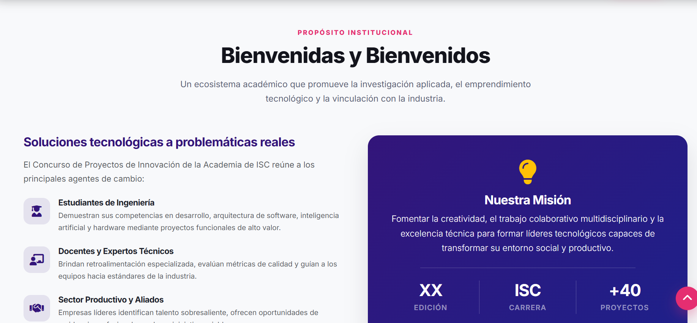
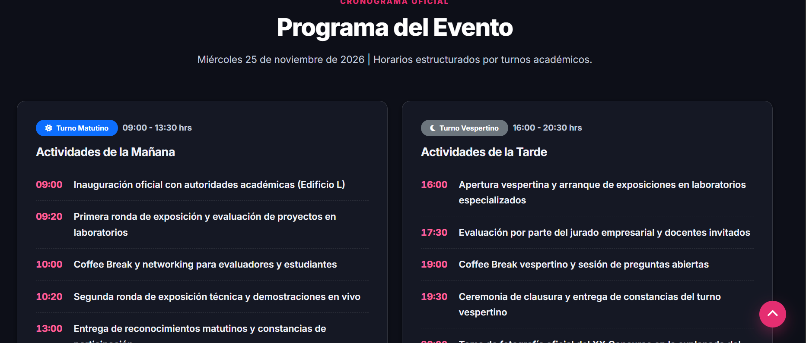
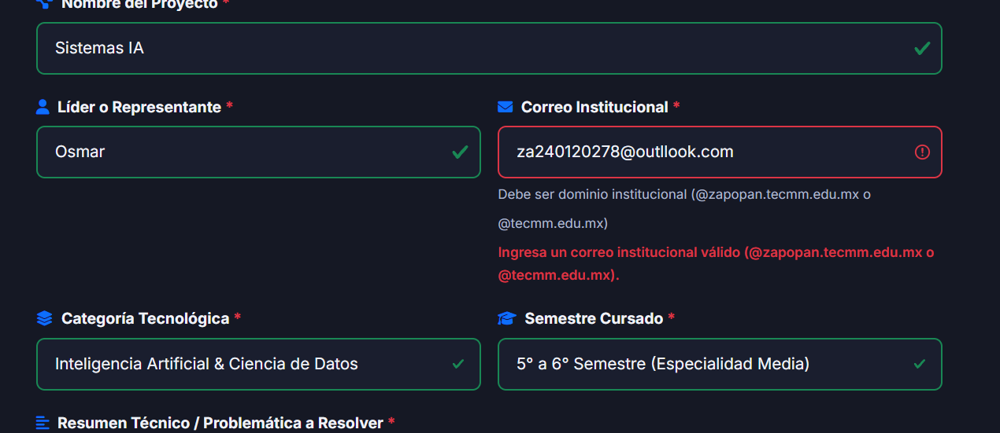
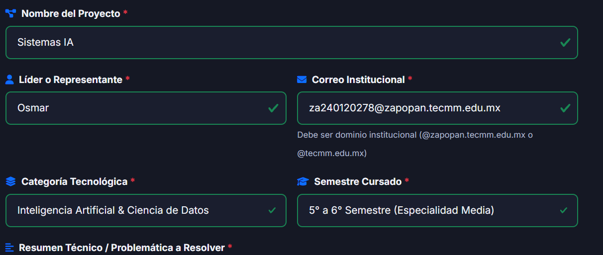

# XX Concurso de Proyectos de Innovación – ISC TecMM Zapopan

[](https://developer.mozilla.org/es/docs/Web/HTML)
[](https://developer.mozilla.org/es/docs/Web/CSS)
[](https://developer.mozilla.org/es/docs/Web/JavaScript)
[](https://getbootstrap.com/)
[](https://developers.google.com/speed/webp)
[](https://pagespeed.web.dev/)

Sitio web oficial y responsivo del **XX Concurso de Proyectos de Innovación** de la Academia de Ingeniería en Sistemas Computacionales del **Instituto Tecnológico José Mario Molina Pasquel y Henríquez (TecMM Campus Zapopan)**.

---

## Enlace al Sitio en Producción (GitHub Pages)

El proyecto está preparado para su despliegue continuo en **GitHub Pages**:

🔗 **[https://osmar453.github.io/Concurso_Proyectos_ISC_Refact/](https://osmar453.github.io/Concurso_Proyectos_ISC_Refact/)**

---

## Lista Detallada de Mejoras Realizadas

La refactorización integral del proyecto abarcó los 4 pilares solicitados, elevando la calidad de código, accesibilidad, desempeño y experiencia de usuario:

### 1. Estructura y Semántica Web (HTML5)
- **Eliminación del "Div Soup":** Se sustituyeron todos los contenedores genéricos `<div>` por etiquetas semánticas de HTML5 estándar:
  - `<header>`: Cabecera principal con barra de navegación institucional.
  - `<nav>`: Navegación accesible con `aria-label="Navegación principal del sitio"`.
  - `<main id="main-content">`: Contenedor principal para englobar el contenido central de la página.
  - `<section>`: Delimitación de cada sección temática (`#inicio`, `#contador`, `#bienvenida`, `#proyectos`, `#programa`, `#labs`, `#sede`, `#organizadores`, `#aliados`, `#faq`, `#registro`, `#cta`).
  - `<article>`: Tarjetas independientes para proyectos tecnológicos, turnos del programa y miembros del comité organizador.
  - `<aside>`: Cuadros de avisos contextuales y ceremonias especiales.
  - `<footer>`: Pie de página estructurado con identidad institucional, mapa de enlaces y canales de contacto.
- **Metadatos Esenciales en el `<head>`:**
  - **SEO Técnico:** Título descriptivo, `meta description`, `keywords`, `author`, `robots (index, follow)`, `theme-color` y URL canonical.
  - **Open Graph (OG):** Soporte de previsualización para WhatsApp, Facebook, LinkedIn, Slack y Telegram (`og:title`, `og:description`, `og:image`, `og:url`, `og:type`, `og:locale`).
  - **Twitter / X Cards:** Etiquetas `twitter:card="summary_large_image"` y recursos gráficos asociados.
- **Accesibilidad Web (WCAG 2.1 AA):**
  - Implementación de un **Skip Link** (`.skip-link`) para saltar directamente al contenido principal con navegación por teclado.
  - Atributos `alt` descriptivos y contextuales en el 100% de las imágenes (eliminando enlaces externos efímeros de Facebook CDN y evitando imágenes rotas).
  - Jerarquía lógica estricta de encabezados: un único `<h1>` en el Hero y distribución ordenada `<h2>` y `<h3>` sin saltos de nivel.
  - Soporte ARIA (`aria-live="polite"` en el reloj regresivo, `aria-expanded`, `aria-controls`, `aria-invalid` y `role="toolbar"` en filtros).

### 2. Diseño, Maquetación y Experiencia de Usuario (CSS3)
- **Modularización del Código:** Se extrajeron los estilos inline y bloques embebidos hacia un archivo desacoplado y limpio en `assets/css/styles.css`.
- **Enfoque Mobile-First:** Maquetación responsiva con CSS Grid y Flexbox que garantiza adaptabilidad óptima desde pantallas ultracompactas (320px) hasta monitores ultrawide (4K).
- **Consistencia Visual con Variables CSS (`:root`):**
  - Paleta institucional oficial del TecMM / ISC:
    - Morado Institucional: `#33157A` (`--primary`)
    - Índigo Oscuro: `#1E208A` (`--secondary`)
    - Fucsia de Acento (CTA): `#E52E71` (`--accent`)
    - Acento Tecnológico: `#00b4d8` (`--accent-cyan`)
    - Fondos limpios y contrastes adaptables.
- **Selector de Modo Claro / Modo Oscuro (Dark Mode):**
  - Botón interactivo con icono animado sol/luna presente tanto en escritorio como en móviles.
  - Detección automática de la preferencia del sistema (`prefers-color-scheme`).
  - Persistencia del tema elegido mediante `localStorage`.
  - Variables de alto contraste que aseguran legibilidad en ambos modos.
- **Microinteracciones y Microanimaciones:**
  - Efectos hover suaves con elevación (`transform: translateY(-4px)`) y resplandor de acento en tarjetas y botones.
  - Estilos de `:focus-visible` accesibles con contraste elevado para navegación por teclado.
  - Barra de navegación con efecto Glassmorphism (`backdrop-filter: blur(14px)`) que añade sombra y opacidad al hacer scroll.
  - Botón flotante "Volver Arriba" con aparición suave tras 400px de desplazamiento.

### 3. Dinamismo e Interactividad (JavaScript Moderno ES6+)
- **Contador Regresivo en Tiempo Real:**
  - Cálculo dinámico de días, horas, minutos y segundos restantes para el **25 de noviembre de 2026 a las 09:00:00 AM**.
  - Formateo con padding de ceros (`padStart(2, '0')`) y actualización periódica precisa cada 1000ms.
  - Mensaje accesible en vivo cuando el evento inicia.
- **Validación Interactiva de Formulario en Tiempo Real:**
  - Formulario de inscripción y contacto en `#registro`.
  - Validación instantánea al perder el foco (`blur`) y al escribir (`input`).
  - **Validación estricta de correo institucional:** Admite únicamente dominios `@zapopan.tecmm.edu.mx` y `@tecmm.edu.mx`.
  - Retroalimentación visual inmediata con clases Bootstrap (`is-valid`, `is-invalid`) y mensajes contextuales sin recargar la página.
  - Simulación asíncrona de envío con botón en estado de carga (spinner), generación de folio de confirmación (`ISC-XXXX`) y alerta de éxito accesible.
- **Catálogo Interactivo con Búsqueda y Filtros:**
  - Galería dinámica de proyectos categorizados: *Inteligencia Artificial*, *Desarrollo Web & Móvil*, *IoT & Embebidos*, y *Ciberseguridad & Redes*.
  - Filtros instantáneos por área temática y buscador reactivo en tiempo real con debounce.
  - Manejo de estado vacío si la búsqueda no arroja resultados.
  - Modal interactivo con ficha técnica ampliada (stack tecnológico, resumen, docentes asesores y equipo).
- **Acordeón de Preguntas Frecuentes (FAQ):**
  - Acordeón colapsable con accesibilidad ARIA para resolver dudas sobre requisitos, jurado, materiales y premiación.

### 4. Rendimiento y Buenas Prácticas
- **Conversión y Optimización de Imágenes a WebP:**
  - Se procesaron y comprimieron todas las imágenes a formato moderno de última generación (`.webp`), reduciendo drásticamente el peso de transferencia (el banner principal se redujo de **1.64 MB a 237 KB, un ahorro del 85.5%**).
  - Implementación de la etiqueta `<picture>` con `source` WebP y fallback a PNG/JPG.
- **Estrategia de Carga Eficiente:**
  - Atributo `loading="lazy"` y `decoding="async"` en todas las imágenes debajo del pliegue (below-the-fold) e iframes (Google Maps y visor de póster).
  - Priorización del recurso crítico (LCP) con `fetchpriority="high"` en la identidad de marca del Hero.
  - Carga diferida de scripts mediante el atributo `defer`.
- **Higiene del Código:**
  - Eliminación de scripts y estilos embebidos en el documento HTML.
  - Estructuración modular: `assets/css/styles.css` y `assets/js/main.js`.
  - Cumplimiento de estándares para alcanzar **puntuaciones superiores a 85 en Google Lighthouse** (Performance, Accessibility, Best Practices y SEO).

---

## Tecnologías y Librerías Utilizadas

| Categoría | Tecnología / Librería | Versión | Propósito |
|---|---|---|---|
| **Estructura** | HTML5 Semántico | Estándar W3C | Maquetación accesible, estructura jerárquica y metadatos SEO / Open Graph |
| **Estilos** | CSS3 Moderno | Nivel 3 | Variables CSS nativas, temas claro/oscuro, grid, flexbox y microinteracciones |
| **Framework CSS** | Bootstrap | 5.3.3 | Sistema de rejilla responsive, modales, alertas y acordeones accesibles |
| **Tipografía** | Google Fonts (Inter) | Variable | Tipografía moderna, de alta legibilidad en pantallas de cualquier resolución |
| **Iconografía** | FontAwesome Free | 6.5.2 | Iconografía vectorial accesible para botones, campos de formulario y navegación |
| **Interactividad** | JavaScript (ES6+) | Vanilla JS | Lógica modular, contador en tiempo real, catálogo dinámico, dark mode y validaciones |
| **Optimización Gráfica** | Pillow (PIL) / WebP | 85% Q | Compresión sin pérdida perceptible de peso y aceleración del tiempo de carga |

---

## Estructura del Proyecto

```text
Concurso_Proyectos_ISC_Refact/
├── assets/
│   ├── css/
│   │   └── styles.css          # Estilos modulares, variables CSS y temas Claro/Oscuro
│   ├── js/
│   │   └── main.js             # Módulos JS: temas, cuenta regresiva, filtros, modal, validación
│   ├── img/
│   │   ├── banner.webp         # Banner hero optimizado (85.5% más ligero)
│   │   ├── banner.png          # Banner original (fallback)
│   │   ├── logotsj.webp        # Logotipo institucional optimizado
│   │   ├── labs-ubicacion.webp # Mapa de sede optimizado
│   │   ├── galeria/            # Imágenes de proyectos y eventos en formato WebP
│   │   ├── labs/               # Croquis y laboratorios (LTE, LTI, LRD, LDS, LIS)
│   │   └── logos/              # Logotipos de patrocinadores y dependencias
│   ├── pdf/
│   │   └── poster.pdf          # Póster oficial del evento para previsualización
│   └── svg/                    # Elementos gráficos vectoriales
├── index.html                  # Documento principal semántico, responsive y accesible
├── README.md                   # Documentación completa y guía de despliegue
└── LICENSE                     # Licencia del proyecto
```

---

## Capturas de Pantalla (Antes y Después)

### Comparativa Visual y Funcional

| Aspecto | Versión Anterior (Antes) | Versión Refactorizada (Después) |
|---|---|---|
| **Estructura** | `<div>` genéricos en todo el documento, sin etiquetas semánticas. | `<header>`, `<nav>`, `<main>`, `<section>`, `<article>`, `<aside>`, `<footer>`. |
| **SEO & Redes** | Sin meta description, sin Open Graph ni Twitter Cards. | Metadatos completos: SEO, OG tags con previsualización para WhatsApp y Twitter Cards. |
| **Tema** | Únicamente tema claro rígido sin variables. | **Selector Claro / Oscuro** con persistencia en `localStorage` y detección del SO. |
| **Proyectos** | Sección estática sin filtros ni interactividad. | **Catálogo dinámico** con búsqueda en tiempo real, filtros por categoría y modal detallado. |
| **Formulario** | Inexistente o sin validación institucional. | **Formulario interactivo** con validación en tiempo real para correos `@zapopan.tecmm.edu.mx`. |
| **Imágenes** | PNG pesados (banner de 1.6MB) y fotos con URLs externas de Facebook 403 rotas. | **Imágenes locales en formato WebP**, `<picture>` con fallback y `loading="lazy"`. |
| **Accesibilidad** | Sin Skip Link, sin estados `:focus-visible`, textos con contraste bajo. | Skip Link, ARIA completo, contraste WCAG 2.1 AA y navegación completa por teclado. |

### Espacio para Evidencia Gráfica (Screenshots)

> **Nota:** Para agregar las capturas a esta sección, guarda tus capturas de pantalla en una carpeta `assets/docs/screenshots/` y referéncialas a continuación:

#### 1. Hero y Cuenta Regresiva (Modo Claro vs Modo Oscuro)
```markdown
| Modo Claro | Modo Oscuro |
|:---:|:---:|
|  |  |
```

#### 3. Validación de Formulario en Tiempo Real
```markdown
| Validación en Vivo (Error vs Válido) | Confirmación de Registro |
|:---:|:---:|
|  |  |
```

---

## Instrucciones de Despliegue en GitHub Pages

Para publicar este proyecto de forma gratuita y automática en GitHub Pages:

1. **Subir los cambios al repositorio remoto en GitHub:**
   ```bash
   git add .
   git commit -m "feat: Refactorización integral HTML5, CSS3, ES6+, Dark Mode y WebP"
   git push origin main
   ```

2. **Habilitar GitHub Pages en el repositorio:**
   - Ingresa a tu repositorio en GitHub: `https://github.com/osmar453/Concurso_Proyectos_ISC_Refact`.
   - Dirígete a la pestaña **Settings** (Configuración) en la parte superior.
   - En el menú lateral izquierdo, haz clic en **Pages**.
   - En la sección **Build and deployment**:
     - **Source:** Selecciona `Deploy from a branch`.
     - **Branch:** Selecciona la rama `main` y la carpeta `/(root)`.
     - Haz clic en el botón **Save** (Guardar).

3. **Verificar el despliegue:**
   - En unos minutos, GitHub Actions completará el despliegue y mostrará la insignia verde con la URL oficial:
   - **`https://osmar453.github.io/Concurso_Proyectos_ISC_Refact/`**

---

## Autor y Créditos

- **Academia de Ingeniería en Sistemas Computacionales**
- **Instituto Tecnológico José Mario Molina Pasquel y Henríquez – Unidad Académica Zapopan**
- Desarrollado y refactorizado con estándares de vanguardia para la comunidad de ISC.
